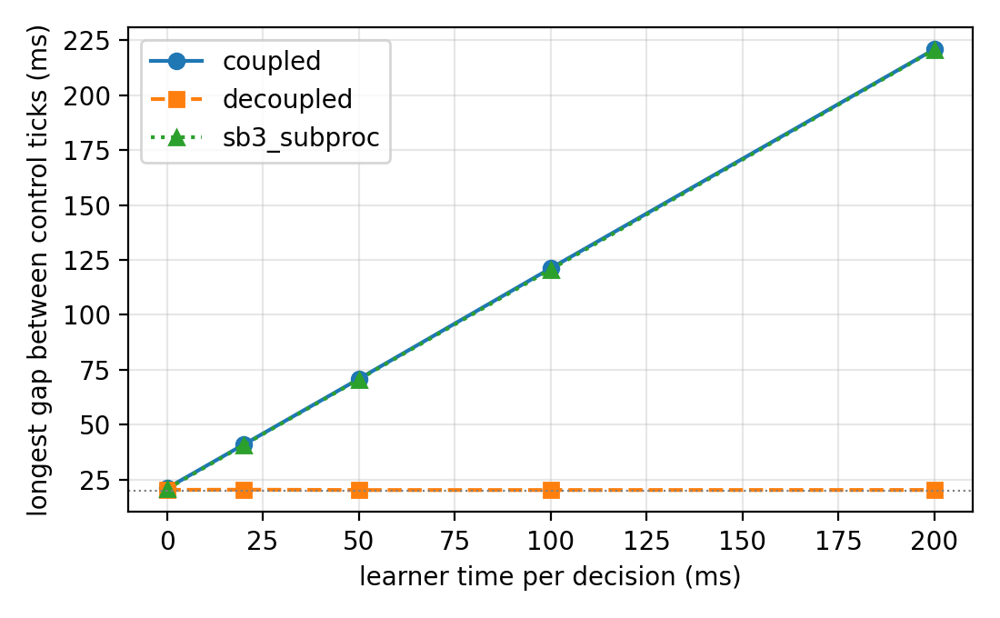

Benchmarks
==========

Two scripts in ``benchmarks/`` reproduce the timing claims. They use only the standard
library (the Stable-Baselines3 baseline runs only if it is installed) and run over the
loopback interface. The numbers below were measured on Linux
6.18 (WSL2) with Python 3.10; absolute values depend on the machine, the shape does not.

Cost of a step
--------------

A step is a request followed by two small replies sent back to back. Without
``TCP_NODELAY`` the second reply waits for the delayed acknowledgement of the receiver.

============== ========= ========= =========
TCP_NODELAY    median    p95       max
============== ========= ========= =========
off            44.000 ms 44.116 ms 48.073 ms
on             0.138 ms  0.204 ms  0.351 ms
============== ========= ========= =========

What decoupling buys
--------------------

An agent runs a control loop with a period of 20 ms and reports to the learner every
100 ms. A coupled agent waits for the next action without running its loop. A decoupled
agent polls ``readWhatToDo()`` on every tick, which returns at once when nothing has
arrived. As a baseline from a widely used library, the same loop also runs inside a
Gymnasium environment under Stable-Baselines3's ``SubprocVecEnv``: the environment has
its own process, but it runs only inside ``step()``. The figure gives the longest gap between two consecutive control ticks as the
learner needs more time per decision.

The gap of the coupled agent, and of the ``SubprocVecEnv`` baseline, grows with the
learner time. The decoupled loop keeps its
period whatever the learner does. The benchmark measures the control loop, not learning
performance, so it does not depend on the algorithm.

To reproduce them, run ``python benchmarks/bench_transport.py`` and
``python benchmarks/bench_decoupling.py`` from the repository root.
